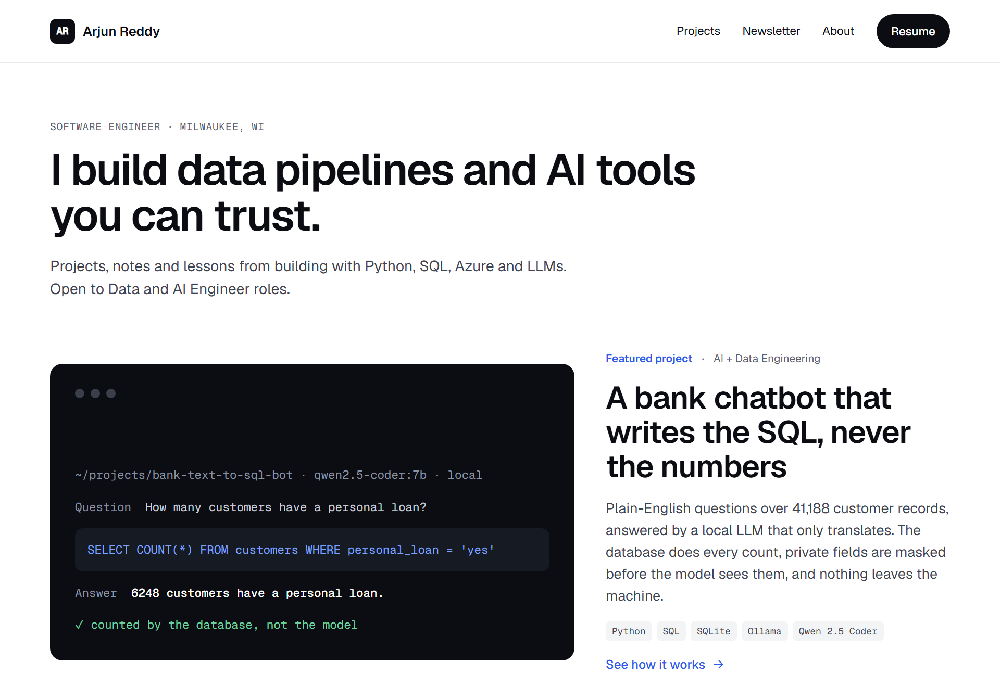

# arjunreddy.dev

The personal site of **Arjun Reddy**, a software engineer in Milwaukee who builds data pipelines and AI tools
you can trust.

**[www.arjunreddy.dev](https://www.arjunreddy.dev)** · [Projects](https://www.arjunreddy.dev/projects/) ·
[About](https://www.arjunreddy.dev/about/) · [Resume (PDF)](https://www.arjunreddy.dev/assets/Arjun_Reddy_Resume.pdf) ·
[LinkedIn](https://www.linkedin.com/in/arjunreddyy7/) · [Email](mailto:arjunreddy0928@gmail.com)

[](https://www.arjunreddy.dev)

## What's on the site

| Section | What it holds | URL |
| --- | --- | --- |
| **Home** | Intro, the featured project, latest writing, projects, newsletter and about | [/](https://www.arjunreddy.dev/) |
| **Writing** | Posts on data engineering, AI, backend work and career, filterable by tag | [/writing](https://www.arjunreddy.dev/writing/) |
| **Projects** | Every project, each with a write-up of how it works, what broke, and the code | [/projects](https://www.arjunreddy.dev/projects/) |
| **Newsletter** | The Build Log: what I'm building, what broke and what I learned | [/#newsletter](https://www.arjunreddy.dev/#newsletter) |
| **About** | Background, current role, education and contact links | [/about](https://www.arjunreddy.dev/about/) |
| **Resume** | The latest PDF, always at the same URL | [/assets/Arjun_Reddy_Resume.pdf](https://www.arjunreddy.dev/assets/Arjun_Reddy_Resume.pdf) |
| **RSS** | Feed of every published post | [/rss.xml](https://www.arjunreddy.dev/rss.xml) |

The Writing section appears on its own once the first post is published.

## Projects

| Project | What it does | Tech | Links |
| --- | --- | --- | --- |
| **Bank Text-to-SQL Bot** (featured) | Plain-English questions over a 41,188-customer bank database. A local LLM writes the SQL and the database does every count, so numbers are never hallucinated. Private fields are masked before they reach the model; queries are read-only; it runs fully offline. | Python, SQL, SQLite, Ollama, Qwen 2.5 Coder | [Write-up](https://www.arjunreddy.dev/projects/bank-text-to-sql-bot/) · [Code](https://github.com/arjunreddy91100/bank-text-to-sql-bot) |
| **TrueFit** | Finds real US job postings, tailors my own resume to each one and shows the gaps. Honesty rules are enforced in code, and it never applies for me. | Python, FastAPI, Ollama, REST APIs | [Write-up](https://www.arjunreddy.dev/projects/truefit/) · [Code](https://github.com/arjunreddy91100/TrueFit-local-honest-you-hit-send) |
| **Daily News Summarization Agent** | Fetches top headlines, summarizes them with AI and posts a digest to Discord every morning at 10 AM. | n8n, OpenAI, Discord | [Write-up](https://www.arjunreddy.dev/projects/daily-news-agent/) · [Code](https://github.com/arjunreddy91100/Daily-News-Summarization-Agent-for-Discord) |
| **Tally** | A shared-expense web app for trips and flatmates, covered by 32 end-to-end tests. | JavaScript, Playwright, GitHub Pages | [Write-up](https://www.arjunreddy.dev/projects/tally/) · [Live](https://arjunreddy91100.github.io/Tally-App/) · [Code](https://github.com/arjunreddy91100/Tally-App) |

## About me

I'm a software engineer with 4+ years of full-time experience. I build backend services and APIs, the data
pipelines that feed them, and AI features. Mostly Python and SQL, with C#/.NET, Angular, Azure and
Databricks alongside.

- **Currently:** Software Developer, Rs Technologies
- **Education:** M.S. Information Technology, University of Wisconsin–Milwaukee
- **Open to:** Software, Data and AI Engineer roles

[LinkedIn](https://www.linkedin.com/in/arjunreddyy7/) · [GitHub](https://github.com/arjunreddy91100) ·
[arjunreddy0928@gmail.com](mailto:arjunreddy0928@gmail.com)

## How the site is built

- **[Astro](https://astro.build)**, static output only: no server, no database, no third-party trackers.
- **Content collections:** every post and project is a Markdown file with checked frontmatter, so adding
  content never means editing HTML.
- **SEO built in:** per-page title, description, canonical URL, Open Graph and Twitter tags, a sitemap,
  `robots.txt` and an RSS feed.
- **Design:** Geist and Geist Mono, one accent blue, a 1200px content width and 16px rounded cards. Every
  layout stacks to one column on phones, and text meets 4.5:1 contrast.
- **Hosting:** GitHub Pages at the custom domain `www.arjunreddy.dev` (`arjunreddy.dev` redirects there),
  deployed by GitHub Actions on every push to `main`.

## Run it locally

Requires Node.js 22.23.4 or newer.

```bash
npm install
npm run dev       # http://localhost:4321, reloads as you edit
npm run build     # static site in dist/, the same check CI runs
npm run preview   # serve the built site locally
```

## Project structure

```
.github/workflows/deploy.yml   Builds and deploys to GitHub Pages on push to main
public/
  CNAME                        Custom domain: www.arjunreddy.dev
  assets/Arjun_Reddy_Resume.pdf
  assets/projects/             Project images
  og.png                       Social preview image
src/
  config.ts                    Links, email, tag list, newsletter settings
  content.config.ts            Frontmatter schema for posts and projects
  content/writing/*.md         Posts
  content/projects/*.md        Projects
  components/                  Header, featured story, cards, newsletter, about
  layouts/Base.astro           Page shell and SEO tags
  pages/                       Routes: home, writing, projects, about, rss.xml, 404
  styles/global.css            Design tokens and styles
HOW-TO.md                      Adding posts and projects, featuring, deploying
```

## Adding content

A new post or project is one Markdown file:

```yaml
# src/content/writing/my-post.md  ->  arjunreddy.dev/writing/my-post/
---
title: "Moving an SSIS pipeline to Azure Data Factory"
date: 2026-11-10
tags: [Data Engineering]
summary: One or two sentences for the card and link previews.
draft: false
---
```

```yaml
# src/content/projects/my-project.md  ->  arjunreddy.dev/projects/my-project/
---
title: My Project
status: Live
category: Data pipeline
summary: What it does, in one or two sentences.
tech: [Python, Airflow, PostgreSQL]
repo: https://github.com/arjunreddy91100/my-project
order: 5
---
```

[HOW-TO.md](HOW-TO.md) covers every field, changing the featured story, turning on the newsletter,
updating the resume and deploying.

## License

The site's code is under the [MIT License](LICENSE). The writing, project write-ups, resume and images are
© 2026 Arjun Reddy.
