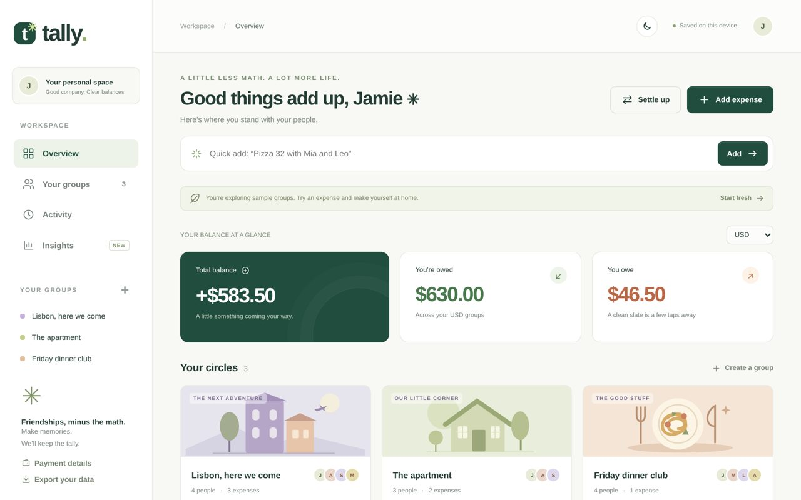

Tally is a calm little app for splitting shared expenses with friends. It runs entirely in the browser as a single `index.html`, with no build step and no dependencies. The [live version](https://arjunreddy91100.github.io/Tally-App/) opens with sample groups, so you can explore right away.

## Why another expense splitter

Splitwise is the best-known app for this, and it's great. Tally exists for the moments where it gets in the way: daily expense limits, ads and a required sign-up on the free plan. Tally has none of those, and keeps private groups in your own browser. What Splitwise still does better: native apps, push notifications and accounts that sync across every device.

## Features

- **Groups and balances.** Settle up suggests the fewest payments that clear everyone's balance.
- **Flexible splits.** Equally, by exact amounts, by percentages or by shares (2 : 1 : 1).
- **Quick add.** Type `Tacos 45 with Alex and Sam yesterday` and Tally fills in the amount, group, people, date and category.
- **Recurring expenses.** Rent or internet repeat weekly or monthly, and missed dates are filled in automatically.
- **Notes and receipt photos,** shrunk in the browser before saving.
- **Payment links.** One-tap UPI, Venmo and PayPal links with the amount pre-filled, plus a "Remind" message.
- **Insights.** Spending by month, by category and by group, who pays most often, and the biggest expenses.
- **Dark mode and a phone layout,** with support for reduced motion.

## Shared groups

When the app is hosted on claude.ai, shared groups sync live between friends' phones. Anywhere else, including the GitHub Pages version, data is saved in each person's browser, with a JSON export for backups. Tally never moves money: pay links open your payment app.

## Tests

32 end-to-end browser tests drive every feature with Playwright, including two simulated phones syncing a shared group.
